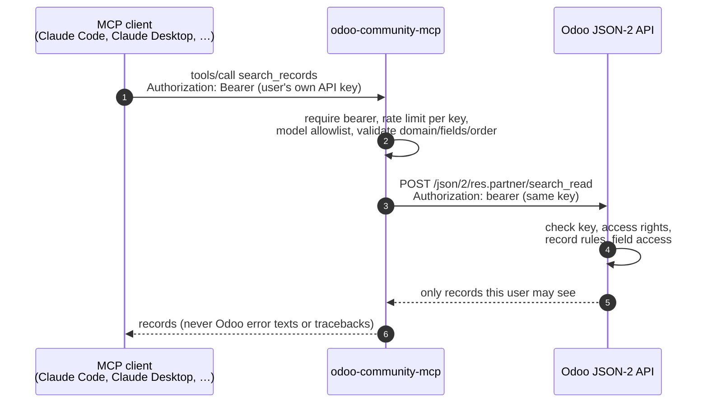

# odoo-community-mcp

A stateless [Model Context Protocol](https://modelcontextprotocol.io) server for
**Odoo 19 and newer**. It lets AI clients such as Claude Code or Claude Desktop read
and, where allowed, write Odoo data — **with each user's own permissions**.



- **Per-user pass-through.** Every request carries the caller's own Odoo API key. The
  server forwards it to Odoo's [JSON-2 API](https://www.odoo.com/documentation/20.0/developer/reference/external_api.html)
  and Odoo enforces access rights, record rules and field access. There is no service
  account and no key is ever stored.
- **One deployment for everyone.** Users only create an API key and configure their client.
- **Selective access per model or app**: e.g. `sale.*` read-write, `account.*` read-only.
  Writing and deleting are off unless the operator enables them, deleting only for
  explicitly named models. There is no generic "call any method" tool.
- **Hardened**: model allowlist, strict validation of domains, fields, sort order and
  written values, per-key rate limit, no tracebacks to clients, keys never logged,
  minimal rootless container image with signed releases.

## For users

### 1. Create an Odoo API key

1. In Odoo, open your avatar → **Preferences** → **Account Security**.
2. Click **New API Key**, confirm your identity, enter a description (e.g. `mcp laptop`)
   and pick a duration. Odoo caps the lifetime (at most three months), so plan to rotate.
3. Copy the key now — Odoo shows it only once. Treat it like a password.

> If you sign in to Odoo only via single sign-on (OAuth) and have no Odoo password,
> Odoo's identity check may block step 2. Ask your Odoo administrator how keys are
> issued in your company (see [Known limitations](#known-limitations)).

### 2. Configure your MCP client

Claude Code:

```sh
claude mcp add --transport http odoo https://odoo-mcp.example.com/mcp \
  --header "Authorization: Bearer <your Odoo API key>"
```

Other clients: add a Streamable HTTP server with the URL `https://<host>/mcp` and the
header `Authorization: Bearer <your Odoo API key>`.

Then ask, for example: *"List the ten newest sale orders of customer Acme."*

### 3. Revoke a key

In Odoo, **Preferences** → **Account Security** → **API Keys**, delete the key. It stops
working immediately, also for this server. Remove it from your client configuration too.

## Tools

Every tool carries a title and all MCP behaviour hints, so clients can ask before writes:

| Tool | Odoo method | Purpose | read-only | destructive | idempotent |
|---|---|---|---|---|---|
| `list_models` | (`ir.model` for wildcards) | Allowed models and their access (`read` / `read-write`) | yes | no | yes |
| `get_fields` | `fields_get` | Field names, types, labels, relations, required and read-only flags | yes | no | yes |
| `search_records` | `search_read` | Search with `domain`, `fields`, `limit` (default 50, max 500), `offset`, `order` | yes | no | yes |
| `count_records` | `search_count` | Count matches of a domain | yes | no | yes |
| `read_records` | `read` | Read records by id | yes | no | yes |
| `create_record` | `create` | Create one record (writable models only) | no | no | no |
| `update_records` | `write` | Set field values on up to 100 records (writable models only) | no | yes | yes |
| `delete_records` | `unlink` | Permanently delete up to 20 records (`rwd` models only) | no | yes | yes |

`create_record` and `update_records` exist only when `ODOO_MCP_ALLOW_WRITE=true` and at least
one model is configured `rw`. They accept plain field types; many2many fields take link
commands (`[4, id]`, `[3, id]`, `[6, 0, [ids]]`); one2many, binary and read-only fields are
refused. `delete_records` exists only when `ODOO_MCP_ALLOW_DELETE=true` too and at least one
model is configured `rwd`; its description tells clients to confirm with the user and to
prefer archiving (`active` = false via `update_records`) where a model supports it.
Odoo's business messages (e.g. a missing required field) are passed on as their
first line, shortened; tracebacks never are.

Domains use Odoo's prefix notation, e.g. `["|", ["name", "ilike", "acme"], ["email", "ilike", "@acme.com"]]`.
Dotted paths such as `country_id.code` are allowed when every model on the path is in the allowlist.
Relations to models outside the allowlist can only be compared by id, cannot be used for
sorting, and their values come back as plain ids (without the related record's name).
Without `fields`, results contain stored, non-binary, non-x2many fields (at most 100).

## Resources

For clients that let users attach context (e.g. Claude Desktop), two MCP resource templates
expose the same data with the same per-user rights and allowlist:

| URI | Content |
|---|---|
| `odoo://schema/{model}` | Fields of a model (type, label, relation, required, read-only) and this server's access level for it |
| `odoo://record/{model}/{id}` | One record with its stored, non-binary fields, e.g. `odoo://record/sale.order/42` |

## For operators

### Run

```sh
docker run -d --name odoo-mcp \
  --read-only --cap-drop ALL --security-opt no-new-privileges \
  -e ODOO_URL=https://odoo.example.com \
  -e ODOO_DB=mydb \
  -e ODOO_MODELS='res.partner, sale.*:rw, account.*:r' \
  -e ODOO_MCP_ALLOW_WRITE=true \
  -e MCP_ALLOWED_HOSTS=odoo-mcp.example.com \
  -p 127.0.0.1:8000:8000 \
  ghcr.io/meevagmbh/odoo-community-mcp:latest
```

Put it behind a TLS-terminating reverse proxy and expose only `https://<host>/mcp`.
`GET /healthz` returns `{"status":"ok"}` without authentication and reveals nothing else.
Responses are plain JSON (no long-lived SSE streams), so proxies need no special
buffering settings.

### Configuration

| Variable | Default | Description |
|---|---|---|
| `ODOO_URL` | – (required) | Base URL of Odoo. Must be `https` unless `ODOO_ALLOW_INSECURE_HTTP=true`. |
| `ODOO_DB` | – (required) | Database name, sent as `X-Odoo-Database`. Never taken from clients. |
| `ODOO_MODELS` | – (required) | Comma-separated model allowlist with access per entry, see below. Other models are refused even if the user may use them in Odoo. |
| `ODOO_MCP_ALLOW_WRITE` | `false` | Master switch for writing. While `false`, every `rw`/`rwd` entry counts as `r` and no write tools are offered. |
| `ODOO_MCP_ALLOW_DELETE` | `false` | Master switch for deleting (needs `ODOO_MCP_ALLOW_WRITE` too). While `false`, every `rwd` entry counts as `rw`. |
| `ODOO_TIMEOUT_SECONDS` | `30` | Timeout per Odoo call. |
| `ODOO_ALLOW_INSECURE_HTTP` | `false` | Allow `http://` to Odoo, only for a trusted internal network. |
| `ODOO_MAX_RESPONSE_BYTES` | `10000000` | Upper bound for one Odoo response. |
| `MCP_ALLOWED_HOSTS` | empty (any) | Comma-separated `Host` header allowlist. Set it in production. |
| `MCP_ALLOWED_ORIGINS` | empty (none) | Browser origins allowed to call the server. Requests with any other `Origin` get 403. |
| `MCP_MAX_BODY_BYTES` | `262144` | Maximum request body. |
| `RATE_LIMIT_PER_MINUTE` | `120` | Requests per minute per API key (`0` disables). Per process. |
| `MCP_PORT` | `8000` | Listen port inside the container. |
| `LOG_LEVEL` | `INFO` | `DEBUG`, `INFO`, `WARNING` or `ERROR`. |

There is deliberately **no** setting for an Odoo API key.

#### Model access (`ODOO_MODELS`)

| Entry | Meaning |
|---|---|
| `res.partner` or `res.partner:r` | read |
| `sale.order:rw` | read and write (needs `ODOO_MCP_ALLOW_WRITE=true`) |
| `res.partner:rwd` | read, write and delete (needs both switches; exact model names only, no wildcards) |
| `sale.*:rw` | every model whose name starts with `sale.` (the Sales app), read and write |
| `account.*:r` | every `account.` model, read only |

`list_models` resolves wildcards into model names only for users who may read `ir.model`
(in Odoo 19+ the "Access Rights" group); everyone else sees the pattern, e.g. `sale.*`, and
uses concrete names such as `sale.order`.

Exact entries win over wildcards, and longer wildcards win over shorter ones, so
`sale.*:rw, sale.report:r` keeps the sales report read-only. The gateway can only narrow
access: Odoo still checks every read and write against the user's own rights.

Odoo requirements: the `rpc` module (auto-installed with `base`), reachable from the
container. Users need keys with the default `rpc` scope.

### Supported Odoo versions

| Odoo | Status | Checked |
|---|---|---|
| 19.0 | supported | every pull request and push (required check) |
| 20.0 | supported | every pull request and push (required check) |
| `odoo:latest` image | early warning | daily and on relevant pull requests, not blocking |
| master (next, unreleased) | early warning | daily from the nightly build, not blocking |

Versions before 19.0 lack the JSON-2 API and are not supported. Tests run against Odoo
Community; Enterprise exposes the same JSON-2 API but is not tested here. A failing daily
early-warning run opens an issue, so incompatibilities show up before a release.

### Logs

JSON lines on stdout, timestamps in UTC. Every tool call produces an audit event with the
key fingerprint (first 8 hex chars of SHA-256), tool, model, outcome, Odoo status, result
count and duration; writes also log the names (not the values) of the written fields.
API keys and Odoo error texts are never logged; request data is not
logged either, except a short, truncated excerpt of input the server rejected.

```json
{"ts": "2026-11-24T22:05:11.518+00:00", "level": "INFO", "logger": "odoo_mcp.audit", "event": "tool_call", "key_fp": "3f9a1c2b", "tool": "search_records", "model": "res.partner", "outcome": "ok", "odoo_status": 200, "result_count": 12, "duration_ms": 84}
```

### Verify an image

Releases are signed keylessly with Sigstore (verify with cosign 3 or newer) and carry SLSA provenance and SBOM attestations.
Each GitHub release also ships SBOMs (SPDX, CycloneDX) and `SHA256SUMS` as assets
(see [SECURITY.md](SECURITY.md#release-evidence-eu-cyber-resilience-act)):

```sh
cosign verify ghcr.io/meevagmbh/odoo-community-mcp:<version> \
  --certificate-identity-regexp '^https://github.com/meevagmbh/odoo-community-mcp/' \
  --certificate-oidc-issuer https://token.actions.githubusercontent.com
gh attestation verify oci://ghcr.io/meevagmbh/odoo-community-mcp:<version> --repo meevagmbh/odoo-community-mcp
```

## Known limitations

- **API keys instead of OAuth.** Each user holds an Odoo API key.
- **SSO-only users.** Odoo asks for the password before it creates a key. Users without a
  password need another way to obtain one, e.g. a key issued by an administrator.
- **Rate limit per process.** With several replicas the effective limit multiplies.

## Development

Requires Docker; Python 3.15 and uv are provided by a pinned container.

```sh
git config core.hooksPath .githooks   # pre-commit: format+lint, pre-push: full checks
scripts/check.sh                      # format, lint, mypy (strict), unit tests with coverage
scripts/integration.sh                # throwaway Odoo 20 + two users, integration tests
ODOO_IMAGE=odoo:19.0 scripts/integration.sh   # same against another Odoo image
ODOO_IMAGE=master scripts/integration.sh      # same against Odoo master (nightly build)
docker build -t odoo-community-mcp:dev . && scripts/image-smoke-test.sh odoo-community-mcp:dev
```

With a local uv ≥ 0.13.8 and Python 3.15 the scripts use it directly.
See [CONTRIBUTING.md](CONTRIBUTING.md) for the workflow, conventions and dependency policy.

### Releasing

1. Bump `version` in `pyproject.toml` on a branch, merge it.
2. Tag the merge commit: `git tag -s vX.Y.Z && git push origin vX.Y.Z`.
3. The release workflow builds a multi-arch image (`linux/amd64`, `linux/arm64`), pushes it
   to GHCR, signs it, attests provenance and creates the GitHub release with notes.
   Every push to `main` also publishes `:edge`.

## License

[MIT](LICENSE)
